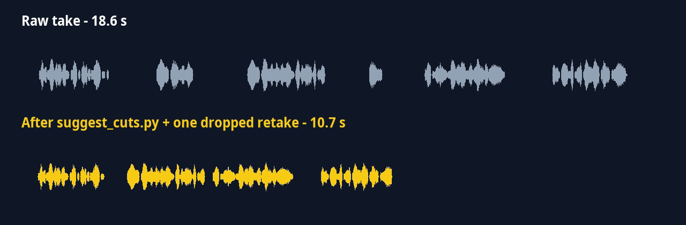
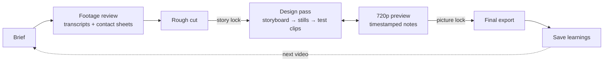

# edit-bay

**Edit videos with Claude Code — no editing app required.**
A Claude Code skill that turns raw footage into finished shorts, reels and vlogs with ffmpeg and Python:
word-level transcripts, frame-accurate rough cuts, word-by-word captions, overlays, sound and final export —
in gated stages, with an edit bay that remembers your notes so every video starts ahead of the last one.

[](#ai-disclosure)
[](LICENSE)


<p align="center">
  
</p>

<p align="center">
  
</p>

<sub>Demo made entirely by this skill from a synthetic voice track: pauses, an “um” and a false start were cut,
captions follow every word, and the card appears when “graphics” is spoken.</sub>

## What it does

- **Transcribes locally** with a timestamp for every word (faster-whisper, no API key).
- **Proposes the rough cut**: removes pauses and filler words, flags retakes, cuts on frame boundaries.
- **Captions word by word** with the spoken word highlighted, pop-in animation, safe-zone placement.
- **Layers graphics, B-roll, sound effects and music** from a simple JSON plan, generated in code.
- **Renders cheap before expensive**: storyboard → stills → short test clips → 720p preview → final export.
- **Validates every plan** before rendering, with error messages that say exactly what to fix.
- **Learns your style**: reference notes capture what you like in other videos; notes become rules in
  `LEARNINGS.md` and playbooks, so the next edit starts from them.

## How it works



Two sign-offs keep rework cheap: **story lock** (content, order and pace are right) before any design work, and
**picture lock** before the full-resolution render. Notes always name a version and timecode —
“preview v2 at 0:12 — the card hides the product — move it top-left.”

## Install

**As a plugin (recommended)** — inside Claude Code:

```
/plugin marketplace add Fluffyattack/edit-bay
/plugin install edit-bay@edit-bay
```

**Manually** — copy the skill folder into your skills directory:

```bash
git clone https://github.com/Fluffyattack/edit-bay
cp -r edit-bay/skills/editing-videos ~/.claude/skills/
```

**Requirements**

| | |
|---|---|
| Python | 3.10+ |
| ffmpeg | with libass and libx264 — macOS `brew install ffmpeg`, Debian/Ubuntu `sudo apt install ffmpeg`, Windows `winget install ffmpeg` |
| Transcription | `pip install faster-whisper` |
| Optional | `pip install pillow` (graphics), `pip install yt-dlp` (saving reference videos) |

Start a new Claude Code session after installing; skills load at startup.

## Quick start

Just talk to Claude Code:

1. “Set up an edit bay in ~/edit-bay.”
2. “Here's a video I like: <link>. Save it as a reference — I love the captions and the pacing.”
3. “Cut ~/edit-bay/inbox/take1.mp4 into a 30-second reel.”

Claude asks for the brief, shows you the rough cut, then a storyboard, stills, test clips and a preview, and
asks which learnings to save at the end.

## What's inside

```
skills/editing-videos/
├── SKILL.md                 workflow, sign-offs, notes → rules
├── guides/                  edit bay, stages, design with code, file formats
├── templates/               edit bay and project templates
└── scripts/
    ├── create_edit_bay.py   set up (or complete) an edit bay
    ├── new_project.py       one folder per video
    ├── transcribe.py        word-level transcript (faster-whisper)
    ├── contact_sheet.py     frame grid with timecodes, so Claude can "see" footage
    ├── suggest_cuts.py      cut list: pauses and fillers out, retakes flagged
    ├── check_plan.py        validate a cut list or overlays plan before rendering
    ├── render_rough_cut.py  frame-accurate rough cut + re-timed words
    ├── make_captions.py     word-by-word ASS captions
    └── render.py            stills, test clips, preview, final export
```

## The edit bay

```
edit-bay/
├── CLAUDE.md       house rules (platforms, fonts, colours …)
├── LEARNINGS.md    rules learned from notes, with reason and origin
├── inbox/          unfiled ideas, memos, raw files
├── references/     reference notes: what exactly works in videos you like
├── playbooks/      proven rules per format (talking-head short, vlog …)
├── library/        sounds, music, fonts, graphic generators
└── projects/       one folder per video
```

## Testing

```bash
python tests/smoke_test.py
```

Runs the whole pipeline on synthetic footage with a fixture transcript (no speech model needed) and checks
filler removal, retake detection, frame-accurate timing, caption events, plan validation, stills, test clips,
preview, contact sheet and full-resolution export.

## Status and limits

Early release (0.1.0). The smoke test passes on Linux (including a Raspberry Pi 4) with ffmpeg 5.1; the scripts are
written to run unchanged on macOS and Windows but have not been tested there yet. Rendering and transcription are
CPU-heavy: on slow machines use the `small` Whisper model or smaller and render previews at 720p.
Reference videos you download are for private analysis — don't put other people's footage or music in your videos.

Issues and pull requests are welcome.

## AI disclosure

**This project is AI-generated.** The code, documentation, templates and demo media were written by Claude
(an AI model by Anthropic) in Claude Code, directed and published by [@Fluffyattack](https://github.com/Fluffyattack).
The automated smoke test passes, but please review the scripts before relying on them for important work.

## License

[MIT](LICENSE)
